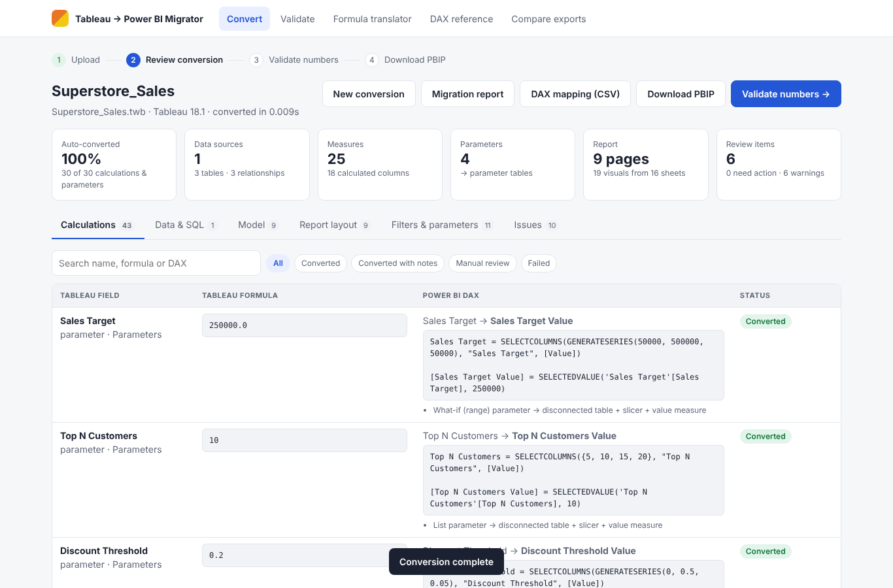

# Tableau → Power BI Migrator

Convert Tableau workbooks (`.twb` / `.twbx`) into Power BI projects (`.pbip`), then **prove the numbers match**.

* **Reads all the workbook metadata:** connections, custom SQL, physical joins, relationships (logical layer), columns
  (types, roles, default aggregation, NULL flags, formats, descriptions, folders, hidden), calculated fields, groups,
  bins, sets, parameters, hierarchies, worksheets (shelves, marks, encodings, filters, sorts), dashboards (zones, quick
  filters, parameter controls, text) and actions.
* **Converts to a best-practice Power BI model:** a star schema with single-direction many-to-one relationships, a
  dedicated `_Measures` table with explicit measures, a marked Date table, Power Query parameters for server and
  database, parameter tables plus value measures, and date-part columns.
* **Translates every calculation to DAX.** This covers row-level calculations (calculated columns), aggregates
  (measures), FIXED / INCLUDE / EXCLUDE LODs, table calculations (WINDOW / OFFSET / ROWNUMBER / RANKX over
  ALLSELECTED), and NULL semantics.
* **Rebuilds dashboards** as report pages (PBIR) with mapped visuals, visual-level filters, slicers and text boxes.
* **Validates the numbers** in four layers: metadata parity, data reconciliation, visual-by-visual cell comparison,
  and parameter/slicer scenarios. Validation runs offline on source data, or live against Tableau Server and the
  Power BI service.
* **Tableau → DAX reference** and an interactive **formula translator**.



## Quick start

```bash
pip install -r requirements.txt
python samples/generate_samples.py          # sample data + 3 sample workbooks (already committed)
python -m tableau2pbi serve --port 8000     # open http://127.0.0.1:8000
```

In the UI: **Convert**, then review the result, then **Validate numbers**, then **Download PBIP**. Open the `.pbip` in
Power BI Desktop (enable *Power BI Project (.pbip) save option* and *Store reports using enhanced metadata format (PBIR)*
in Options > Preview features). Then set the data source credentials and refresh.

### Command line

```bash
# convert + validate against a copy of the source tables
python -m tableau2pbi convert samples/workbooks/Superstore_Sales.twb -o out/superstore \
       --sqlite samples/data/superstore.db --as-of 2025-12-31

# validation only (exit code 2 when numbers differ)
python -m tableau2pbi validate samples/workbooks/HR_Analytics.twbx --validate --html report.html

python -m tableau2pbi translate "{FIXED [Customer Name] : MIN([Order Date])}"
python -m tableau2pbi compare tableau_crosstab.csv powerbi_export.csv --keys Region,Category
```

Already-converted samples are in [`samples/output/`](samples/output). Each folder holds the PBIP project, the migration
report, the validation report and the DAX mapping.

## How validation works

| Layer | Checks | Source of truth |
|---|---|---|
| L1 Metadata parity | Every calculation, parameter, worksheet, dashboard, filter, column and relationship has a counterpart | Workbook inventory |
| L2 Data reconciliation | Row counts, column sums, NULL counts, distinct counts | Source SQL = Tableau data source = Power BI tables |
| L3 Visual reconciliation | Every worksheet vs its visual, cell by cell (abs 0.01 / rel 1e-6 tolerance) | Tableau-semantics engine vs DAX engine |
| L4 Scenarios | Parameter changes, slicers on dimensions outside the view | Same engines with changed inputs |

The **Tableau engine** (`validation/tableau_engine.py`) applies Tableau semantics:
- Record-level FIXED LODs.
- View-grain INCLUDE / EXCLUDE.
- The Tableau filter order (context → Top N → dimension → measure → table calc).
- Table-calc addressing and partitioning.
- NULL propagation.

The **DAX engine** (`validation/dax_engine.py`) parses and executes the *generated DAX* with:
- Filter context and row context.
- Context transition.
- CALCULATE modifiers.
- Relationship propagation.
- BLANK arithmetic.
- Window functions.

The two engines are independent implementations, so agreement between them is evidence the translation is right.

**Live mode** (`validation/live.py`) compares the published reports:
- Tableau side: REST API sign-in with a Personal Access Token, then each view's data.
- Power BI side: the generated DAX query per visual, run through `executeQueries`.

Two other comparison paths: the **Compare exports** screen compares a Tableau crosstab with a Power BI *Export data*
file, and every validated visual shows its DAX query for DAX Studio.

## Project layout

```
tableau2pbi/
  parser.py            TWB/TWBX metadata reader
  model.py             metadata model
  formula/             Tableau formula parser + DAX translator
  converter.py         semantic model, visuals, pages, filters, parameters
  mcode.py             connections + custom SQL -> Power Query (M)
  pbip/writer.py       PBIP: TMDL semantic model + PBIR report
  validation/          Tableau engine, DAX engine, comparator, orchestrator, live clients
  catalog.py           Tableau -> DAX reference (generated by the translator)
  report.py            JSON + HTML migration / validation reports
  web/                 FastAPI app + single-page UI (no external dependencies)
samples/               data generator, sample workbooks, converted outputs
tests/                 131 automated tests + Playwright UI walkthrough
docs/                  test report (Markdown + Word), screenshots, test evidence
```

## Testing

```bash
python -m pytest -q                  # 131 tests: parser, translator, engines, PBIP integrity, validation, API, live clients
python docs/build_test_report.py     # full campaign: pytest + browser UI walkthrough + 25 UAT cases + defect injection
```

Results are in [docs/TEST_REPORT.md](docs/TEST_REPORT.md) and [docs/Test_Report.docx](docs/Test_Report.docx).

## Conversion rules (summary)

| Tableau | Power BI |
|---|---|
| Relationships | Star schema; hub table = fact; many-to-one, single direction |
| Physical joins | `Table.Join` in Power Query (keeps Tableau numbers); optional star schema (`--joins star`) |
| Custom SQL | `Value.NativeQuery(..., [EnableFolding=true])`; `<Parameters.X>` → Power Query parameter |
| Row-level calc | Calculated column (`RELATED` for dimension columns, NULL-safe operators) |
| Aggregate calc | Measure in `_Measures` (`DIVIDE`, iterators for expressions) |
| `{FIXED dims : agg}` | Calculated column: `CALCULATE(agg, REMOVEFILTERS(), dim = current)` |
| `{INCLUDE / EXCLUDE}` | Measure: `AGGX(SUMMARIZE(fact, dims), CALCULATE(agg))` / `CALCULATE(agg, REMOVEFILTERS(dims))` |
| Table calcs | `WINDOW`, `OFFSET`, `ROWNUMBER`, `RANKX` over `ALLSELECTED(addressing)` |
| COUNTD | `DISTINCTCOUNTNOBLANK`; dimension-table columns cross-filtered through the fact |
| Group / bin / set | `SWITCH(TRUE(), col IN {...})` / `FLOOR(col, size)` / `col IN {...}` or `RANKX(...) <= N` |
| Parameter | Disconnected table (`GENERATESERIES` / list) + slicer + `SELECTEDVALUE` measure |
| Filters | Basic / Advanced / TopN / RelativeDate visual filters; measure filters on aggregated values |
| Dashboard | Report page (zones scaled to 1280×720), quick filters and parameter controls become slicers |

Known limitations are listed in the [test report](docs/TEST_REPORT.md#10-known-limitations-and-recommendations).
